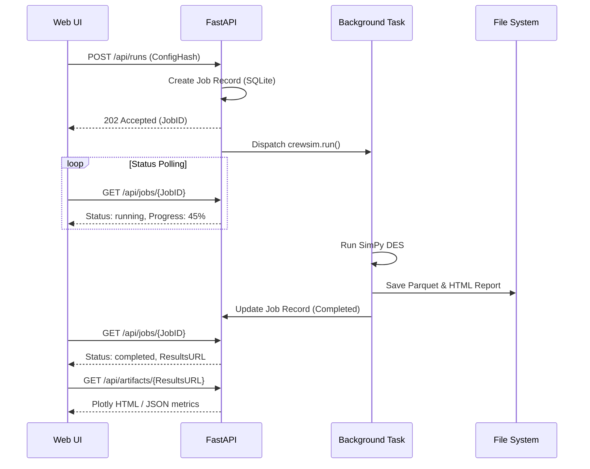

# CrewSim Web UI: Technical Architecture

## 1. System Architecture Diagram

```mermaid
graph TD
    %% Web UI Layer
    subgraph WebUI ["Web UI (Presentation Layer)"]
        A[Browser / Client]
        B[State Management & Caching]
        A <--> B
    end

    %% Application API Layer
    subgraph API ["Application API (FastAPI)"]
        C[API Gateway / Router]
        D[Job Service]
        E[Config & Run Service]
        F[Metrics & Report Service]
        C <--> D
        C <--> E
        C <--> F
    end

    %% Engine Layer
    subgraph Engine ["Simulation Engine (crewsim python package)"]
        G[SimPy DES Engine]
        H[Calibration Pipeline]
        I[Cascade Evaluator]
    end

    %% Data & Persistence
    subgraph Data ["Data & Artifacts"]
        J[(SQLite/Metadata DB)]
        K[File System (Parquet, JSON, HTML)]
    end

    %% Connections
    B <-->|REST / SSE| C
    D -->|Executes async| Engine
    E -->|Reads/Writes| J
    E -->|Reads/Writes| K
    F -->|Reads results| K
    Engine -->|Outputs| K
    Engine -->|Updates status| J
```

## 2. Frontend Architecture

*   **Framework**: **React + Vite** (or Next.js depending on SEO/SSR needs, though Vite + SPA is highly efficient for internal offline-capable analytical tools). Rationale: Massive ecosystem for data grids (AG Grid / TanStack Table) and charting (Plotly.js / Recharts).
*   **Component Architecture**:
    *   `pages/`: Route-level components mapping to Epics (e.g., `/runs`, `/config`, `/calibration`).
    *   `layouts/`: AppShell, Sidebar, Headers.
    *   `components/`: Reusable design system UI elements (Cards, Buttons, Badges).
    *   `features/`: Domain-specific components (e.g., `LegalityRuleEditor`, `CascadeTimeline`).
*   **State Management**:
    *   *Server State*: **TanStack React Query**. Handles API fetching, caching, deduplication, and polling for job statuses.
    *   *Local UI State*: **Zustand** or React Context for lightweight global state (e.g., sidebar toggles, theme). Form state managed locally via `react-hook-form`.
    *   *URL State*: Aggressive use of query parameters for filters, pagination, and active tabs to ensure run comparisons and views are shareable/bookmarkable.
*   **Performance Strategy**:
    *   Large grid results (R4-R14) and logs use DOM virtualization (e.g., `@tanstack/react-virtual`) to maintain 60fps.
    *   Lazy load heavy charting libraries and report HTML artifacts.

## 3. Backend API Architecture

*   **Framework**: **Python FastAPI**. Rationale: Native Python integration with the existing `crewsim` package, high performance, auto-generated OpenAPI schemas, and native async support for managing simulation jobs.
*   **Service Boundaries**:
    *   `ConfigService`: CRUD for `BaseConfig` and `CostsConfig`. Validates JSON schemas. Generates blake2b hashes for config state.
    *   `SimulationService`: Orchestrates the SimPy DES run. Spawns background worker processes.
    *   `CalibrationService`: Manages Regime/Sick-Call/Delay calibration routines.
    *   `RunService`: Queries historical runs, manages provenance (linking outputs to inputs).
    *   `ArtifactService`: Serves HTML Plotly reports, CSV exports, and Parquet data.
    *   `JobService`: Queue management, polling endpoints, and Server-Sent Events (SSE) for live logging.
*   **Persistence Layer**:
    *   **Metadata**: SQLite database (via SQLAlchemy) to store Run metadata (ID, timestamp, status, duration, user).
    *   **Artifacts**: File system storage. JSON for param stores and configs. `.parquet` for scenario data and large simulation event ledgers. HTML for generated static reports.

## 4. Long-Running Operations Pattern

Simulations and calibrations can take minutes to hours. The UI must never block or timeout.

1.  **Job Creation**: Client sends `POST /api/runs`.
2.  **Immediate Response**: Server responds HTTP 202 Accepted with a `Job ID` and status `queued`.
3.  **Execution**: Server passes the task to a background queue (e.g., Celery, or FastAPI `BackgroundTasks` / internal ThreadPool for local deployments).
4.  **Monitoring**: Client subscribes to `GET /api/jobs/{id}/stream` (SSE) for live log appending and percentage updates, or falls back to polling `GET /api/jobs/{id}` every 2 seconds.
5.  **Completion/Failure**: Job state transitions to `completed` or `failed`. SSE connection closes. Client invalidates React Query cache and fetches the final result artifact.
6.  **Resilience**: If the user closes the browser, the job continues. Returning to the `/runs` page fetches the active job list from SQLite and reattaches the UI to the running job.

## 5. Data Flow Diagrams

### Simulation Execution Flow


## 6. Security Considerations

*   **Execution Sandbox**: The application executes Python code (simulation logic) locally. If exposed over a network, ensure strict input validation on Config files to prevent path traversal or injection via malicious scenario generation params.
*   **CORS**: Configure strict Cross-Origin Resource Sharing if the Web UI and API are served from different ports during development.
*   **Data Integrity**: Use blake2b hashing (matching the engine's standard) to verify that the config used to trigger a run matches the artifact output. 

## 7. Deployment Architecture

*   **Desktop/Local Mode (Analyst Persona)**: Packaged as a local server. The user runs a command (e.g., `crewsim ui`), which spins up the FastAPI server on `localhost:8000` and serves the static Vite frontend. Opens automatically in the default browser.
*   **Server Mode (Team Persona)**: Deployed via Docker Compose.
    *   Container 1: Nginx (serving static UI & reverse proxy to API).
    *   Container 2: FastAPI Web Server.
    *   Container 3: Celery Worker (for executing heavy engine tasks).
    *   Volume Mount: Shared file system for SQLite and Parquet artifacts.
