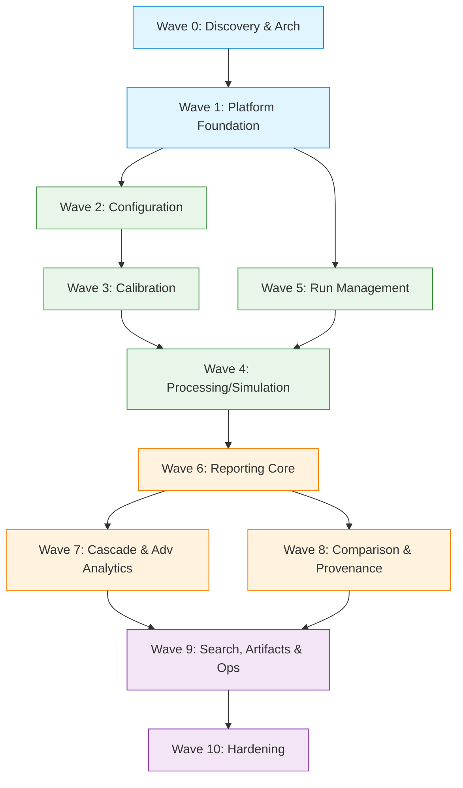

# Implementation Waves & Project Plan

## 1. Dependency Graph

## 2. Implementation Waves

**Wave 0 — Discovery & Architecture**
- Repository analysis and domain modeling.
- CLI to API mapping design.
- UX Architecture and Design System selection.

**Wave 1 — Platform Foundation**
- App shell, routing, and persistent navigation (desktop sidebar, mobile header).
- Design system scaffolding (KPI cards, basic tables, skeletons, forms).
- API client foundation and database schema for Runs and Jobs.

**Wave 2 — Configuration**
- Config discovery, viewing, and basic validation.
- Expose policies and cost parameters to the UI.

**Wave 3 — Calibration**
- Launching calibration routines.
- Monitoring calibration job status.
- Viewing calibration results, diagnostics, and generated artifacts.

**Wave 4 — Processing**
- Simulation launch wizard (policy selection, seed injection).
- Monitoring simulation execution.
- Grid execution setup.
- Scenario generation triggers.

**Wave 5 — Run Management & Jobs**
- Run history, detail view, and semantic statuses.
- Background Job lifecycle (queued, running, completed, failed, cancelled).
- Live log streaming.

**Wave 6 — Reporting Core**
- KPI Dashboard (E[cost], CVaR95, eligibility fraction).
- Cost breakdown charts and distribution analysis.
- Exemplar scenario drilldowns (costliest vs typical).

**Wave 7 — Cascade & Advanced Analytics**
- Cascade timeline visualization and detail drill-down.
- Gate results dashboard (V1-V9).
- Data quality reports (pass/marginal/fail).

**Wave 8 — Comparison & Provenance**
- Run vs Run, Policy vs Policy comparison.
- Provenance chain (Sim Version → Config → Calibration → Policy → Seed).
- Explain command integration (`explain-legality`, `explain-crew`, etc.).

**Wave 9 — Search, Artifacts & Platform**
- Command palette cross-entity search.
- Artifact browser and download manager.
- Observability (API health, execution durations) and audit logs.

**Wave 10 — Hardening**
- Complete accessibility audit (a11y).
- Responsive polish across all breakpoints.
- Performance optimization (load times, rendering large datasets).
- Contextual error handling review.

## 3. Parallelization Opportunities

Once **Wave 1** is complete, the following streams can happen concurrently:
- **Stream A (Execution):** Waves 2, 3, 4, 5 (Config, Calibrate, Process, Jobs).
- **Stream B (Analytics):** Waves 6, 7 (Reporting, Cascade). *Mock data can be used to build the dashboards before the backend executes actual simulations.*
- **Stream C (Platform):** Wave 9 (Search, Artifacts) can be developed independently using the foundation API.

## 4. Backend Prerequisites per Wave

| Wave | Required API Services |
|---|---|
| W1 | Basic CRUD for Runs/Jobs, API Authentication/Health. |
| W2 | Config parser API, parameter schema validation endpoint. |
| W3 | Calibration job runner trigger, calibration results endpoint. |
| W4 | Engine trigger API, seed injection, scenario generator hook. |
| W5 | Job queue worker (Redis/Celery), WebSocket/SSE for logs. |
| W6 | Aggregation endpoints for Parquet/CostLedger metrics. |
| W7 | `explain-cascade`, `gate v1-v9`, and `data quality` API wrappers. |
| W8 | Run diffing endpoint, `explain-*` trace API endpoints. |
| W9 | Global search indexer, S3/Local artifact streaming API. |

## 5. Definition of Done (MVP Completion)

**Objective Statement**:
"A user can perform the complete simulator lifecycle through the web application without requiring the CLI, while retaining the same simulation behavior, reproducibility, traceability, and analytical depth."

**Checklist**:
1. All core simulation phases (calibrate, scenario generation, run, compare) are functional via UI.
2. End-to-end traceability from macro KPI down to specific CostLedger entry.
3. Gates V1-V9 are viewable and verify reproducibility (Seed + Config).
4. No full-page blocking spinners; graceful skeleton loading.
5. All forms preserve input on error and validate on blur.
6. Responsive design supports desktop, tablet, and mobile viewing.
7. Keyboard navigation and screen-reader accessibility (WCAG AA target).
8. Contextual error states ("What happened, Why, What next").
9. Explain tools natively integrated as UI side-panels/modals.
10. Data Quality reports available before simulation execution.
11. Job queue handles browser disconnects gracefully.
12. Comprehensive artifact downloading.
13. No direct CLI execution required for any MVP workflows.

## 6. Risk Register

| Risk | Impact | Likelihood | Mitigation Strategy |
|---|---|---|---|
| **Data Volume in Browser** | High | High | Render virtualized lists for logs/tables. Ensure backend handles aggregation (e.g., CVaR) rather than sending raw scenarios to client. |
| **Long-Running Job Disconnects** | High | Med | Decouple UI from execution using a robust Job Queue (e.g., Celery). Use SSE for status updates rather than polling. |
| **Loss of Reproducibility** | Critical | Low | Enforce immutable Run records. Detach "Effective Config" at run-time. Gate V7 integration in UI. |
| **Complex Cascade Visualization** | Med | High | Start with a simplified tabular timeline (WD-002) before investing in heavy D3/Canvas graphing. |
| **API Wrapper Overhead** | Med | Med | Map CLI commands directly to stateless API endpoints where possible; cache heavy outputs. |
