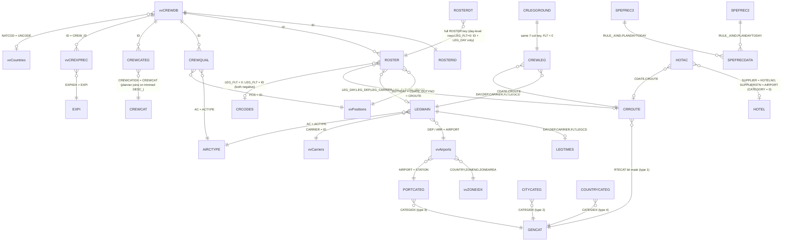

# TSC (AIMS) semantic layer - planner-assist-mcp

Generated 2026-11-03 from (a) the SQL in `database\dbo` and `database\rpt`, (b) read-only catalog metadata and aggregate profiling of the live server
(`10.180.1.10`, instance `PPR-MTLSQLAIMS1\AIMS`), (c) naming inference. No data was written to the database. No personal data is reproduced here.

## 1. Scope and database topology

| Database | Role | In scope |
|---|---|---|
| `TSC` | The AIMS operational database: 672 tables, 200 views, 4 procedures (AIMS-native, names are upper-case tables such as `ROSTER` and `vv*` views). | The **38 objects** documented: the 37 the planner code touches (26 tables, 11 views) plus `ROSTERDT` (added from the draft-extraction backlog query). The other ~800 objects are not documented because nothing in the repo uses them. |
| `CrewSchedAI` | Planner-assist database: holds every procedure/function of this repo (schemas `dbo` and `rpt`) plus 4 small configuration tables. Procedures reach AIMS with 3-part names `TSC.dbo.<object>`. | 4 tables, 4 table-valued functions, 1 table type (`CrewIdList`). Other tables there (`customer`, `address`, `loyalty_account`, `account_balance`, `acc_point_type_balance`, `identifier`, `sysdiagrams`) are unrelated to crew planning and are not documented. |

Facts about the metadata: **no foreign keys are declared, no MS_Description exists, and the `vv*` view definitions are not readable** (encrypted or no VIEW DEFINITION right). Every relationship below is therefore inferred from procedure code and verified by data profiling.
Lengths of `nchar` columns in `_raw\columns.json` are in bytes (real length = half). Collation is `SQL_Latin1_General_CP1_CI_AS` (accent-sensitive).

## 2. How to read the model (5-minute version)

AIMS stores a **planned/rostered airline operation**. Business concepts and where they live:

| Concept | Object(s) | Grain |
|---|---|---|
| Flight leg (scheduled/operated flight sector) | [LEGMAIN](tables/LEGMAIN.md), actual times in [LEGTIMES](tables/LEGTIMES.md) | one leg = `(DAY, DEP, CARRIER, FLT, LEGCD)` |
| Pairing / trip (a named duty-period sequence, instantiated on a start day) | [CRROUTE](tables/CRROUTE.md) | one pairing instance = `(CDATE, CROUTE)` |
| Which legs make up which pairing (N:M bridge, also complement requirements per leg) | [CREWLEG](tables/CREWLEG.md); ground (non-flying) elements in [CRLEGGROUND](tables/CRLEGGROUND.md) | pairing x leg |
| Roster: crew member x element (flight, ground leg or stand-alone activity) | [ROSTER](tables/ROSTER.md), header [ROSTERID](tables/ROSTERID.md) | crew x leg/duty element |
| Roster attributes (typed EAV rows on a roster element); **carries the DRAFT marker** (RECTYPE 21, VALUE1 15/16 = PNC, 19/20 = PNT) | [ROSTERDT](tables/ROSTERDT.md), concept note [drafts.md](drafts.md) | roster element (or crew-day) x RECTYPE |
| Activity code dictionary (leave, rest, reserve, training, ground transport, ...) | [CRCODES](tables/CRCODES.md) | one code |
| Crew master data | [vvCREWDB](tables/vvCREWDB.md) (personal data!) | one crew member (`ID`) |
| Crew categories | [CREWCAT](tables/CREWCAT.md) (dictionary), [CREWCATEG](tables/CREWCATEG.md) (assignment with validity) | crew x category x validity |
| Qualifications | [CREWQUAL](tables/CREWQUAL.md) | crew x aircraft x position x base x validity |
| Currency/expiry types and records | [EXPI](tables/EXPI.md), [vvCREXPREC](tables/vvCREXPREC.md) | expiry type / crew x expiry type |
| Positions (CM, PO, DV, AB, SU, ...) | [vvPositions](tables/vvPositions.md), planner class in [position_category](tables/position_category.md) | one position |
| Aircraft types | [AIRCTYPE](tables/AIRCTYPE.md), decoded in [vvAIRCTYPE](tables/vvAIRCTYPE.md) | one type |
| Airports, time zones, countries, carriers | [vvAirports](tables/vvAirports.md), [vvZONEIDX](tables/vvZONEIDX.md), [vvCountries](tables/vvCountries.md), [vvCarriers](tables/vvCarriers.md) | one airport / zone rule / country / carrier |
| Generic categories (route, city-pair, airport, country, flight categories) | [GENCAT](tables/GENCAT.md); memberships [ACCATEG](tables/ACCATEG.md), [ACCATEG2](tables/ACCATEG2.md), [PORTCATEG](tables/PORTCATEG.md), [PORTCATEG2](tables/PORTCATEG2.md), [CITYCATEG](tables/CITYCATEG.md), [COUNTRYCATEG](tables/COUNTRYCATEG.md) | category x member x validity |
| System registry of packed tables | [TABLES](tables/TABLES.md) (blob records), decoded by [vvFMSCodes](tables/vvFMSCodes.md) and [vvFMSInfo1](tables/vvFMSInfo1.md) | one record |
| Custom scheduling rules ("with / with-not", "certain flights for certain crew") | [SPEFREC2](tables/SPEFREC2.md), [SPEFREC3](tables/SPEFREC3.md), [SPEFRECDATA](tables/SPEFRECDATA.md) | rule x plan/day-to-day |
| Hotel accommodation | [HOTAC](tables/HOTAC.md) (bookings), [HOTEL](tables/HOTEL.md) (master) | booking / hotel |
| Allowances credited to FTC | [vvALLWRDC](tables/vvALLWRDC.md) | crew x day |
| Planner configuration (CrewSchedAI) | [position_category](tables/position_category.md), [crew_base_timezone](tables/crew_base_timezone.md), [FtcLegalLimit](tables/FtcLegalLimit.md), [draft_order10_crews](tables/draft_order10_crews.md), [CrewIdList](tables/CrewIdList.md) | - |
| Functions | [fn_GetEffectiveOffset](tables/fn_GetEffectiveOffset.md), [fn_GetEffectiveOffsetUtc](tables/fn_GetEffectiveOffsetUtc.md), [fn_GetEffectiveOffset_v1](tables/fn_GetEffectiveOffset_v1.md), [fn_GetCivilTwilight](tables/fn_GetCivilTwilight.md) | - |

## 3. Relationship map

All edges are *inferred* (no declared FKs). Cardinality/predicate details are in the `Keys & relationships` section of each file.

## 4. Cross-cutting encodings (read this before writing SQL)

1. **AIMS day number** - dates are integers counting days since **1980-01-01** (`DATEADD(DAY, n, '1980-01-01')`); 2026-11-03 = 17108. Applies to `DAY`, `CDATE`, `DUTYDAY`, `LEG_DAY`, `ADATE`, `ENDDATE`, `ACTIVEBEG/END`, `EXPIDATE`, block dates, etc. Validity ends: `0` = since always / not set, `32767` (2069-09-17) = open ended (exception: `EXPI.EFFECTIVE_END = 0` = open ended).
2. **Minutes** - flight, roster and LEGTIMES times are **UTC minutes after 00:00 of the row's day column**; they may exceed 1440 or be negative, so the calendar instant is `DAY + minutes/1440`. Local time needs the airport offset (`vvAirports` + `vvZONEIDX` via the offset functions).
3. **Composite keys, no surrogate keys** - leg `(DAY, DEP, CARRIER, FLT, LEGCD)`, pairing `(CDATE, CROUTE)`, crew `ID`. `ROSTER` carries the leg key as `LEG_*` and the pairing key as `DUTYDAY`/`DUTYNO`.
4. **Roster element kinds** - `LEG_FLT >= 0` flight; `LEG_FLT < 0 AND DUTYNO < 0` stand-alone activity (`LEG_FLT = CRCODES.ID`, both <= 0); `LEG_FLT < 0 AND DUTYNO > 0` ground leg inside a pairing. `GRDDUTYBEG = GRDDUTYEND = 0` are untimed placeholders.
5. **Own operation filter** - `LEGMAIN.CARRIER = 1` (home carrier, `vvCarriers` code TSC) and `CANCELLED = 0`; other carrier ids are partners or surface transport.
6. **Packed blobs** - many "meaning" columns are bit masks or byte offsets inside `DATA_BEGIN_END` / `CATEG*` / `CREWNUM` / `POS` columns (e.g. `CRCODES` description, rest/leave/reserve/training flags, `HOTAC` check-in/out). Indexing differs per column (`EXPI.POS` -> `vvPositions.ID-1`; `EXPI.MULT_AC` -> `AIRCTYPE.ACORDER-1`; category masks start at byte 1 or 3). Details per object.
7. **Wide `vv*` views are decoders** of `TABLES` / `*.DATA_BEGIN_END` blobs: they usually return a single row (`vvFMSCodes`, `vvFMSInfo1`) or one row per entity with hundreds of columns (`vvCREWDB` 287, `vvAirports` 124). Select explicit columns only.
8. **Active-period joins** (`ACTIVEBEG/ACTIVEEND`, `ACTIVBEG/ACTIVEND`) are **inclusive** in AIMS, but several procedures use strict comparisons; replicate the intended inclusive rule in new SQL.
9. **Size traps** - `ROSTER` 14.4M, `HOTAC` 8.4M (always `PROCESSSTATUS = 0` first; all its indexes start with it), `CREWLEG` 1.85M, `LEGMAIN` 1.23M, `CRROUTE` 0.56M; `vvALLWRDC` ~4.6M rows (always filter `ID` and `DAY`).
10. **Personal data** - `vvCREWDB` and `ROSTERID` hold names, addresses, contacts, passport, next-of-kin. An agent must select only the operational columns it needs.
11. **Drafts** - recorded in `ROSTERDT` (`RECTYPE = 21`, `VALUE1` in 15/16/19/20), per leg (element level) or per crew-day (`LEG_FLT = 0`). `R0_GetDraftList` only forecasts candidates. Tested extraction: `queries/drafted_legs.sql` (see [drafts.md](drafts.md)).

## 5. Procedure -> object matrix (automatically derived by name matching)

| Procedure / function | Objects referenced |
|---|---|
| `dbo.crew_base_timezone` | `crew_base_timezone`, `CREWQUAL` |
| `dbo.CrewIdList` | `CrewIdList` |
| `dbo.draft_order10_crews` | `draft_order10_crews` |
| `dbo.FtcLegalLimit` | `FtcLegalLimit` |
| `dbo.GetCivilTwilight` | `GetCivilTwilight` |
| `dbo.GetEffectiveOffset_v1` | `vvAirports`, `vvZONEIDX` |
| `dbo.GetEffectiveOffset` | `GetEffectiveOffset`, `vvAirports`, `vvZONEIDX` |
| `dbo.GetEffectiveOffsetUtc` | `GetEffectiveOffset`, `GetEffectiveOffsetUtc`, `vvAirports`, `vvZONEIDX` |
| `dbo.position_category` | `CREWQUAL`, `position_category`, `ROSTER`, `vvPositions` |
| `dbo.R0_GetDraftList` | `AIRCTYPE`, `CRCODES`, `crew_base_timezone`, `CREWCAT`, `CREWCATEG`, `CrewIdList`, `CREWLEG`, `CREWQUAL`, `CRLEGGROUND`, `CRROUTE`, `draft_order10_crews`, `EXPI`, `LEGMAIN`, `LEGTIMES`, `position_category`, `ROSTER`, `ROSTERID`, `vvAIRCTYPE`, `vvCREWDB`, `vvCREXPREC`, `vvFMSInfo1`, `vvPositions` |
| `dbo.R1_Get_Violations_CertainFlightsCrew` | `CREWCAT`, `CREWCATEG`, `CRROUTE`, `SPEFREC3`, `vvCountries`, `vvCREWDB` |
| `dbo.R2_Get_Violations_Schedule_WithWithNot` | `CREWCAT`, `CREWCATEG`, `CRROUTE`, `HOTEL`, `SPEFREC2`, `vvCREWDB` |
| `dbo.R3_Get_Violations_RestTime_Batch` | `CRCODES`, `CrewIdList`, `CREWLEG`, `CREWQUAL`, `CRLEGGROUND`, `CRROUTE`, `GetEffectiveOffset`, `GetEffectiveOffsetUtc`, `HOTAC`, `HOTEL`, `LEGMAIN`, `LEGTIMES`, `position_category`, `ROSTER`, `vvAirports`, `vvCarriers`, `vvCREWDB` |
| `dbo.R3_Get_Violations_RestTime` | `CRCODES`, `CREWLEG`, `CREWQUAL`, `CRLEGGROUND`, `CRROUTE`, `GetEffectiveOffset`, `GetEffectiveOffsetUtc`, `HOTAC`, `HOTEL`, `LEGMAIN`, `LEGTIMES`, `position_category`, `ROSTER`, `TABLES`, `vvAirports`, `vvCarriers`, `vvCREWDB` |
| `dbo.R4_Get_Future_Impact` | `CRCODES`, `CRROUTE`, `ROSTER`, `TABLES` |
| `dbo.R4_Get_Violation_FDP` | `CRCODES`, `CREWLEG`, `CREWQUAL`, `CRLEGGROUND`, `CRROUTE`, `GetEffectiveOffset`, `LEGMAIN`, `LEGTIMES`, `position_category`, `ROSTER`, `TABLES`, `vvAirports`, `vvCarriers`, `vvCREWDB` |
| `dbo.R5_Get_Violation_FTC` | `CRCODES`, `CREWLEG`, `CRLEGGROUND`, `CRROUTE`, `FtcLegalLimit`, `LEGMAIN`, `LEGTIMES`, `position_category`, `ROSTER`, `TABLES`, `vvAirports`, `vvALLWRDC`, `vvCarriers`, `vvCREWDB` |
| `rpt._prompt_igonre` | `TABLES` |
| `rpt.CalculateCrewFTC` | `CRCODES`, `CREWLEG`, `CRLEGGROUND`, `CRROUTE`, `FtcLegalLimit`, `LEGMAIN`, `LEGTIMES`, `position_category`, `ROSTER`, `vvAirports`, `vvALLWRDC`, `vvCarriers`, `vvCREWDB` |
| `rpt.get_crew_categories` | `CREWCAT`, `CREWCATEG` |
| `rpt.get_crew_certifications` | `CREWCAT`, `CREWCATEG`, `CREWQUAL`, `EXPI`, `vvAIRCTYPE`, `vvCREWDB`, `vvCREXPREC`, `vvPositions` |
| `rpt.get_crew_qualifications` | `CREWQUAL`, `vvFMSInfo1`, `vvPositions` |
| `rpt.Get_Custom_Rules_CertainFlightsCrew` | `CREWCAT`, `GENCAT`, `SPEFREC3`, `SPEFRECDATA`, `TABLES`, `vvAIRCTYPE`, `vvFMSCodes`, `vvPositions` |
| `rpt.Get_Custom_Rules_Schedule_WithWithNot` | `CREWCAT`, `GENCAT`, `SPEFREC2`, `SPEFRECDATA`, `TABLES`, `vvAIRCTYPE`, `vvFMSCodes`, `vvPositions` |
| `rpt.Get_Detailed_Pairing` | `ACCATEG`, `ACCATEG2`, `CITYCATEG`, `COUNTRYCATEG`, `CREWCAT`, `CREWCATEG`, `CREWLEG`, `CRROUTE`, `GENCAT`, `GetCivilTwilight`, `GetEffectiveOffset`, `HOTAC`, `HOTEL`, `LEGMAIN`, `PORTCATEG`, `PORTCATEG2`, `ROSTER`, `TABLES`, `vvAIRCTYPE`, `vvAirports`, `vvCarriers`, `vvFMSCodes`, `vvPositions` |
| `rpt.list_aircraft_types` | `AIRCTYPE` |
| `rpt.list_crew_categories` | `CREWCAT` |
| `rpt.list_crew_positions` | `vvPositions` |
| `rpt.list_instructor_qualifications` | `vvFMSInfo1` |
| `rpt.lookup_airport` | `vvAirports` |
| `rpt.lookup_crew` | `vvCREWDB` |
| `rpt.usp_GetPairingID` | `CREWLEG`, `CRROUTE`, `ROSTER` |
| *(backlog)* `DRAFTPNCPNT.sql` (copy: `queries/DRAFTPNCPNT.original.sql`) | `ROSTER`, `ROSTERDT` |
| *(tested)* `queries/drafted_legs.sql` | `ROSTERDT`, `ROSTER`, `CRROUTE`, `LEGMAIN`, `LEGTIMES` |

Purpose of the procedure families: **R0** draft/seniority list (who can be drafted onto a pairing), **R1** violations of "certain flights for certain crew" rules, **R2** violations of with/with-not crew-pairing rules, **R3** rest-time rules (incl. bio-clock/acclimatisation offsets), **R4** FDP (flight duty period) limits and future impact, **R5** FTC (flight time credit) limits, `rpt.*` lookups and rule/pairing read models for the MCP tools.

## 6. Findings worth a human review (found while documenting; none were changed)

These are observations about the *repo SQL versus the data*, with the evidence in the table files. Each should be validated against AIMS business rules before fixing.
1. `HOTAC`: the "AIRPORT LOUNGE" exclusion is tested against `HOTAC.DATA_BEGIN_END` and never matches; the name lives in `HOTEL` (88 hotels), so ~1,282 live 2026 lounge bookings are counted as hotels. R3 also subtracts the airport-hotel transit distance twice.
2. `CRCODES` joins: R0/R3/R4 join on `DUTYNO` and so miss ground legs inside pairings; the correct code key for non-flights is `LEG_FLT` itself (`CRCODES.ID <= 0`).
3. `ROSTER.REPORTTIME/DEBRIEFTIME` overrides are anchored on `LEG_DAY` in R0/R3/R4 but on `DUTYDAY` in R5/`CalculateCrewFTC`.
4. Active-period strict comparisons in `rpt.Get_Detailed_Pairing`, no begin-date test in R1 and `rpt.get_crew_certifications`, `ACTIVEEND > today` in `rpt.get_crew_categories`: validity boundaries are inconsistent.
5. `R0`: `CHARINDEX(CODE, DESC_)` on `vvPositions` does not match DV and DA; `EXPIDATE < end` does not exclude `EXPIDATE = 0`; live `EXPI` types with a future `EFFECTIVE_END` are ignored.
6. `dbo.GetCivilTwilight` adds the time-of-day of the input to its result and `Get_Detailed_Pairing` passes a datetime with time; `Twilight_*`/`Is_Overnight` are therefore suspect. It computes silently for 0,0 when airport coordinates are blank (19 airports).
7. `dbo.GetEffectiveOffset_v1` mis-handles "last Sunday" DST rules (unused). 5 airports (`ECP, YTM, BYJ, TSF, CAX`) have `ZONENO = 0` and yield a NULL offset; `YWG` resolves to a no-DST zone while `crew_base_timezone` says Central.
8. `rpt.Get_Custom_Rules_Schedule_WithWithNot` always labels `Rule_Type` as 'DayToDay' regardless of the filter; R2 evaluates a single orientation for same-position rules with different category lists; category names are the text join key between pairings and rules (renaming a `GENCAT` row silently changes behaviour).
9. `position_category` classes ME as PNC while AIMS marks it as cockpit (`CK_CB = 0`).
10. Backlog `DRAFTPNCPNT.sql` (draft extraction): day-level draft markers (`ROSTERDT.LEG_FLT = 0`) are copied onto every ROSTER row of the crew-day (11 markers -> 59 rows in 2026-01); the element-level join omits `DUTYNO, DUTYDAY, GRDDUTYBEG`; date filters wrap `LEG_DAY` in `CAST(DATEADD(...))` (non-sargable); no pairing name or departure time is output. Corrected version: `queries/drafted_legs.sql`.

## 7. Confidence legend used in the table files
**High** = stated in code comments or confirmed by code *and* data; **Medium** = consistent with code and data but not stated; **Low/inferred** = name-based; **unknown** = no procedure uses it. Anything labelled inference must not be treated as a business rule.

## 8. Folder layout
- `drafts.md` - how drafted pairings are recorded in AIMS (`ROSTERDT`), annotated backlog query, pitfalls, tested retrieval.
- `corpus/` - **CrewSim corpus (D1-D12) feasibility from AIMS**: [CORPUS_FEASIBILITY.md](corpus/CORPUS_FEASIBILITY.md) (verdict table + gaps) and four detailed mapping files with tested SQL sketches (also document newly discovered objects: `PROSTER`, `LOG_ROSTER`, `LOG`, `TIMEPNCPNT`, `LEGDELAYS`, ...).
- `corpus/migration/` - **migration plan to read AIMS live** ([MIGRATION_PLAN.md](corpus/migration/MIGRATION_PLAN.md)) and the **supplement request for Pierre** ([PIERRE_SUPPLEMENT_SPEC.md](corpus/migration/PIERRE_SUPPLEMENT_SPEC.md), 21 CSV schemas in `pierre_schemas/templates`, synthetic `examples`, pre-filled `prefilled/m01_activity_code_map.prefilled.csv`).
- `corpus/migration/PIERRE_QUESTIONS.md` - 30 clarification questions for Pierre (French, ready to send, + English copy); `corpus/migration/sim_ddl/sim_schema.sql` - **proposed, not executed** DDL for schema `sim` in `CrewSchedAI` (pseudonym map and mapping tables).
- `corpus/migration/CrewSim_Courriel_et_Questions_Pierre_FR.docx` - **Word document for Pierre (French)**: the email, the three summary tables (what AIMS covers, which of his files stay relevant, the 21 supplement files) and the 30 questions.
- `queries/` - `DRAFTPNCPNT.original.sql` (copy of the backlog query) and `drafted_legs.sql` (tested corrected extraction).
- `tables/<OBJECT>.md` - one file per object (9 fixed sections: purpose, physical facts, column dictionary, keys, encodings, procedure usage, query patterns, data profile, open questions).
- `_raw/` - reproducible extraction: `_extract.ps1` (catalog metadata -> json), `q.ps1` (read-only SELECT helper), `columns.json`, `indexes.json`, `rowcounts.json`, `view_defs.json` (empty definitions), `crewschedai_*.json`, `proc_matrix.txt`, `_brief.md` (the documentation brief).

