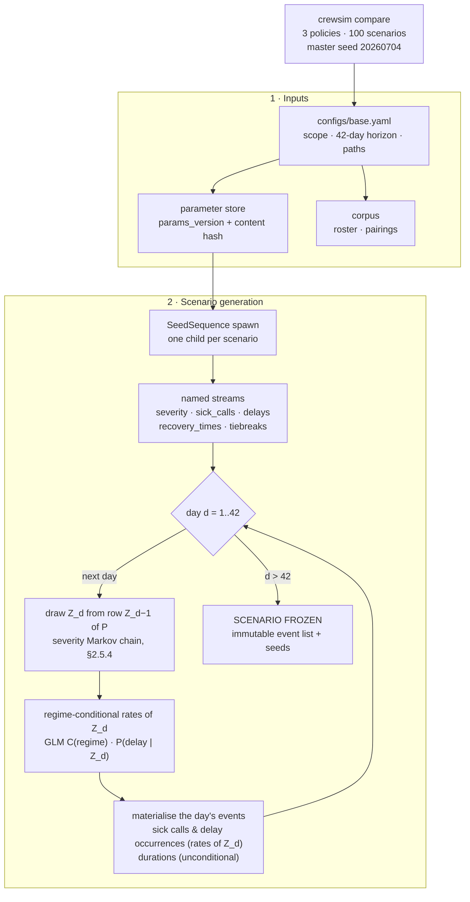
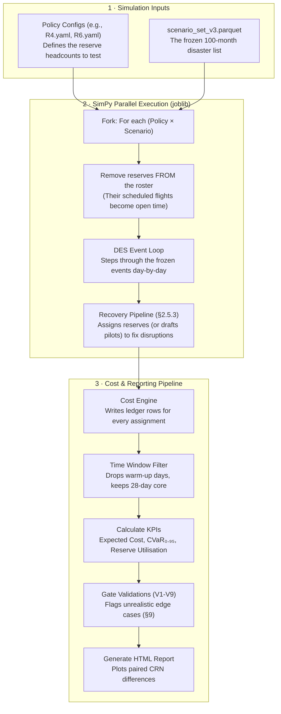
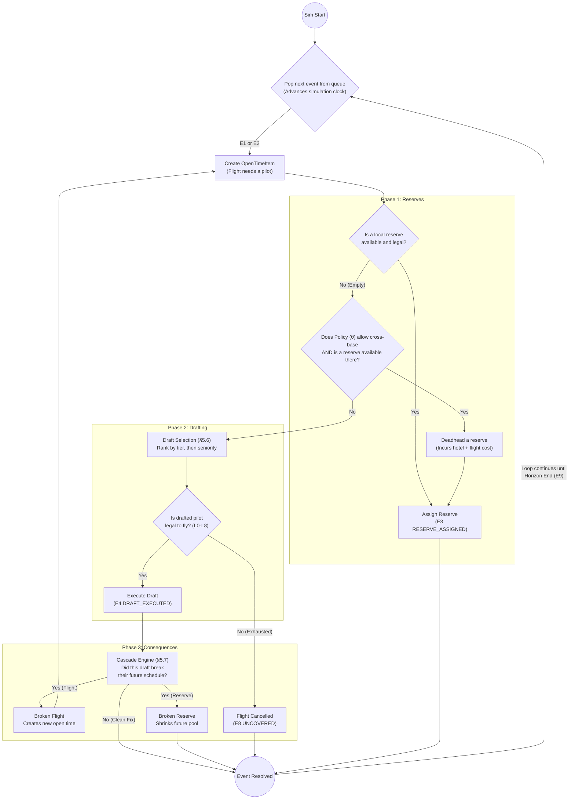
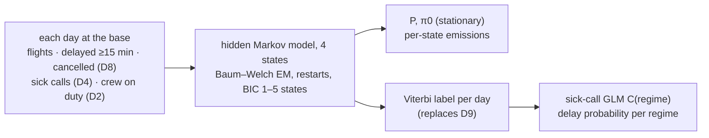
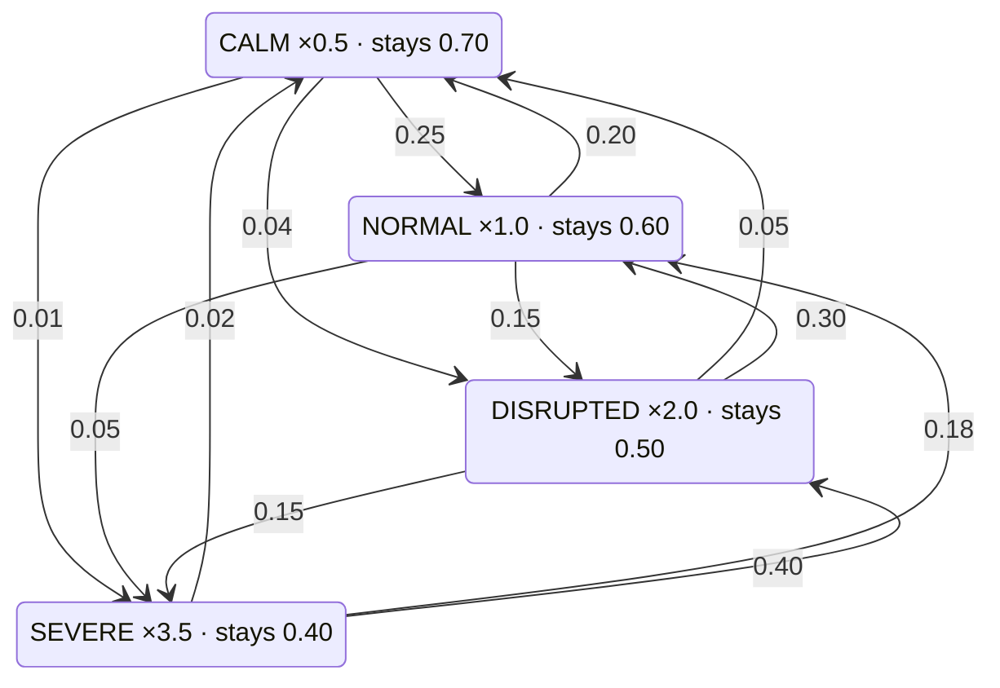

# 2. High-Level Architecture

**Version:** 3.0 (Air Transat instantiation, engineering edition) · **Date:** 2026-08-05

---
## What this section is

The system diagram and, more usefully, the four architectural rules that everything else obeys. Read
§2.3 ("Architectural commitments") even if you skip the diagram — those four rules are the ones that
get violated first and hurt most.

Two views of the same system: **§2.1** is static (what the parts are), **§2.5** is runtime (what
executes, in order, from the command to the report — including the severity Markov chain, the CRN seed
tree and the recovery pipeline). §2.4 sits between them as the narrative walkthrough of one run.

---

## 2.1 The pipeline

Six layers, strictly one-directional. Data flows down; nothing flows back up.

> This is the **static** view — what the parts are. §2.5 is the **runtime** view: what actually
> executes between the command and the HTML report, including where the severity Markov chain is
> drawn and why it is drawn *before* the simulation rather than inside it.

```
┌─────────────────────────────────────────────────────────────────┐
│                     HISTORICAL DATA LAYER                        │
│  Rosters │ Pairings │ Sick calls │ Draft events │ Pay │ OTP      │
│                  (Delta Lake / Parquet corpus)                   │
└───────────────────────────────┬─────────────────────────────────┘
                                │  batch ETL + calibration jobs
                                ▼
┌─────────────────────────────────────────────────────────────────┐
│                 STATISTICAL CALIBRATION LAYER                    │
│  • Sick-call arrival model (NHPP; covariates: season, DOW,       │
│    base, fleet, category)                                        │
│  • Disruption-severity regime model (latent daily state, HMM)    │
│  • Delay / IROPS event models                                    │
│  • Crew-status distributions (for validation targets)            │
│  • Cost parameter calibration (pay rules → CAD coefficients)     │
│  Output: versioned parameter store (JSON/Parquet + hash)         │
└───────────────────────────────┬─────────────────────────────────┘
                                │  fitted distributions
                                ▼
┌─────────────────────────────────────────────────────────────────┐
│           SCENARIO GENERATOR  (Monte Carlo, CRN-seeded)          │
│  • SeedSequence-based hierarchical RNG streams                   │
│  • One scenario = one realisation of all disruption streams      │
│    over the bid period                                           │
│  • The scenario set is FIXED across all candidate policies       │
└───────────────────────────────┬─────────────────────────────────┘
                                │  scenario event streams
                                ▼
┌─────────────────────────────────────────────────────────────────┐
│              DISCRETE EVENT SIMULATION CORE (SimPy)              │
│                                                                  │
│   ┌──────────────┐   ┌────────────────────┐   ┌──────────────┐  │
│   │ Crew State   │◄──│  Event Dispatcher  │──►│ Reserve      │  │
│   │ Engine       │   │  (sick call, delay,│   │ Eligibility  │  │
│   │ (legality    │   │  duty end, rest    │   │ Engine       │  │
│   │  surrogate)  │   │  end, cascade)     │   │              │  │
│   └──────┬───────┘   └─────────┬──────────┘   └──────┬───────┘  │
│          │                     │                     │          │
│          ▼                     ▼                     ▼          │
│   ┌──────────────┐   ┌────────────────────┐   ┌──────────────┐  │
│   │ Draft        │   │ Cascade Evaluation │   │ Cost Engine  │  │
│   │ Candidate    │──►│ (emergent from     │──►│ (event-level │  │
│   │ Selection    │   │  state updates)    │   │  ledger)     │  │
│   │ (tier +      │   └────────────────────┘   └──────────────┘  │
│   │  seniority)  │                                              │
│   └──────────────┘                                              │
└───────────────────────────────┬─────────────────────────────────┘
                                │  per-scenario cost ledgers + KPIs
                                ▼
┌─────────────────────────────────────────────────────────────────┐
│                POLICY OPTIMISATION ENGINE                        │
│  • Policy = (reserve vector R, drafting params θ)                │
│  • Evaluation: run all CRN scenarios → E[C], CVaR, service KPIs  │
│  • Search: Bayesian optimisation (R) + ranking & selection (θ)   │
│  • Parallel execution: joblib (MVP) → Ray / AKS (scale)          │
└───────────────────────────────┬─────────────────────────────────┘
                                │  policy comparison results
                                ▼
┌─────────────────────────────────────────────────────────────────┐
│                DECISION SUPPORT REPORTING                        │
│  • Recommended reserve vector per bid period + drafting params   │
│  • E[cost], CVaR₀.₉₅, cost breakdown by category                 │
│  • Reserve utilisation, draft frequency by crew-status tier      │
│  • Cascade frequency (validated vs. historical ≈20%)             │
│  • Eligibility rate (validated vs. historical ≈30%)              │
│  • Trade-off curves (reserve level ↔ drafting cost)              │
│  • Drill-down to exemplar scenarios per recommendation           │
└─────────────────────────────────────────────────────────────────┘
```

---

## 2.2 Layer-by-layer, for the engineer who has to build it

### Layer 1 — Historical Data Layer

**What it is.** A read-only Parquet/Delta corpus of what actually happened at Air Transat over the last
two to three years. Twelve source extracts, specified in §6.1.

**What it is not.** A live connection to crew tracking. This layer is refreshed by batch ETL; the
simulation never queries an operational system.

**The hard part.** Air Transat's crew tracking system, like almost every airline's, does **not** have a
column called `was_drafted`. Draft events have to be *reconstructed* by joining schedule-change records
against premium pay codes (§6.3-1). That reconstruction is on the critical path for two of the three
validation gates — see the schedule warning in §3.

**Interface:** `crewsim.data.load_corpus(dataset: str, window: DateRange) -> pl.LazyFrame`

### Layer 2 — Statistical Calibration Layer

**What it is.** Batch jobs that turn history into fitted distributions. Runs rarely (monthly in
Phase 3, once per data refresh before that).

**Output contract.** A single versioned artefact:

```json
{
  "params_version": "v3.2.1",
  "fitted_at": "2026-08-05T14:22:00Z",
  "data_window": ["2023-08-01", "2026-07-31"],
  "season": "winter_sun",
  "sick_call_nhpp": {"family": "NegBin", "coefficients": {"...": "..."}, "dispersion": 1.84},
  "severity_regime": {"method": "hidden_markov_model",
                      "states": ["CALM","NORMAL","DISRUPTED","SEVERE"],
                      "transition_matrix": [[...]], "intensity_multipliers": [0.5,1.0,2.0,3.5],
                      "emissions": {"SEVERE": {"delay_probability": 0.40, "...": "..."}},
                      "fit": {"log_likelihood": -1853.2, "bic": 3860.6, "...": "..."}},
  "validation_targets": {"eligibility_rate": {"mean": 0.31, "ci": [0.27, 0.35]},
                         "cascade_rate":     {"mean": 0.19, "ci": [0.15, 0.24]}},
  "content_hash": "blake2b:9f2c..."
}
```

Every simulation run records `params_version` and `content_hash` in its metadata. This gives a complete
reproducibility chain: **data → params → scenarios → policy → results.** A year from now, when someone
asks why the January recommendation was 14 reserves, that chain is the answer.

> **Fit per season.** Air Transat's summer Atlantic and winter sun programmes have different disruption
> physics. One parameter store per season (§4.5.2), not one for the year.

### Layer 3 — Scenario Generator

**What it is.** A pure function from a seed to an immutable event stream. `generate_scenario(id, seed)
-> Scenario`. No policy input, no simulation state, no I/O.

**Why it is a separate layer.** Because that purity is what makes CRN work. If scenario content
depended on the policy under test, two policies would see different Januaries and every comparison
would be confounded.

**What one scenario contains:** a 42-day sequence of daily severity states, the sick calls those states
generate, the delay events, and the administrative durations (notification-to-report, deadhead times).
It is Parquet-serialisable and can be regenerated bit-identically from its seed alone.

**Example output (JSON equivalent):**

```json
{
  "scenario_id": 47,
  "seed": 20260704047,
  "horizon_days": 42,
  "daily_severity": ["NORMAL", "NORMAL", "DISRUPTED", "SEVERE", "NORMAL", "..."],
  "events": [
    {
      "event_id": "sc_47_001",
      "type": "SICK_CALL",
      "timestamp": "2026-11-03T05:40:00Z",
      "crew_id": "fo_012",
      "duration_days": 2
    },
    {
      "event_id": "dl_47_002",
      "type": "DELAY",
      "timestamp": "2026-11-04T13:00:00Z",
      "flight_id": "TS123",
      "delay_minutes": 180
    }
  ]
}
```

### Layer 4 — Discrete Event Simulation Core

**What it is.** SimPy drives a clock; six engines do the actual work.

| Engine | Responsibility | Pure? |
|---|---|---|
| Crew State Engine | Holds every crew member's calendar; performs the three audited mutations | Yes |
| Legality Surrogate | `is_legal_assignment(state, duty) -> LegalityResult` for rules L0–L8 | Yes |
| Reserve Eligibility Engine | Which reserves can legally take this open item | Yes |
| Draft Candidate Selection | Which line-holder to draft, by impact tier then seniority | Yes |
| Cascade Evaluation Engine | Consumes each mutation's `StateDelta`; emits downstream disruptions | Yes |
| Cost Engine | Books one ledger row per costed event | Yes |

**The dependency rule, restated because it matters:** none of those six imports `simpy`. `des.py` is a
thin orchestration layer that receives events and calls engines. This is what lets the legality
surrogate be tested with hypothesis in microseconds.

### Layer 5 — Policy Optimisation Engine

**MVP:** no optimiser. A hand-picked grid of candidate policies, evaluated exhaustively and compared
pairwise under CRN. This is deliberate — an optimiser searching over a model you have not yet validated
finds the model's bugs, not the airline's optimum.

**Phase 2:** Bayesian optimisation (Optuna TPE) over the integer reserve lattice, crossed with
ranking-and-selection over the small discrete set of `θ` variants. See §4.5.1 on why fleets are
separate sub-problems rather than extra dimensions.

### Layer 6 — Decision Support Reporting

**MVP:** one self-contained HTML file per run. It must always include drill-down to exemplar scenarios
— the five costliest and five most typical — because a planner will not act on an aggregate they cannot
interrogate. "Why 14?" must have an answer that is a specific simulated Tuesday.

---

## 2.3 Architectural commitments

Four rules. Violating any one of them costs weeks later.

### C1 — Separation of randomness and logic

> All randomness is materialised by the Scenario Generator *before* simulation, or drawn from
> per-scenario named RNG streams. **Given a scenario, the DES core is deterministic.**

This is what makes CRN, reproducibility and debugging possible. When a run produces a strange number,
you can replay exactly that scenario under a debugger and watch it happen.

The subtle failure mode, and the reason this is a *rule* rather than a preference:

```python
# WRONG — the number of draws depends on how many drafts the policy made,
# so policy A and policy B fall out of alignment and CRN silently stops working.
recovery_time = shared_rng.lognormal(mu, sigma)

# RIGHT — a generator keyed by (scenario, stream, event) is the same number
# for the same event regardless of what the policy did beforehand.
recovery_time = rng.event_rng("recovery", event_uid).lognormal(mu, sigma)
```

And the seed derivation must itself be process-stable (defect **D2**): use `blake2b`, never Python's
built-in `hash()`, which is salted per interpreter by `PYTHONHASHSEED`.

**Expected Artifact Example (Scenario Stream):**
```json
{
  "scenario_id": 47,
  "master_seed": 20260704,
  "scenario_seed": "blake2b:1a2b3c4d5e...",
  "horizon_days": 42,
  "events": [
    {
      "event_id": "evt_47_001",
      "type": "SICK_CALL",
      "sim_time": "2026-11-03T05:40:00Z",
      "crew_id": "fo_012",
      "duration_days": 2
    },
    {
      "event_id": "evt_47_002",
      "type": "DELAY",
      "sim_time": "2026-11-04T13:00:00Z",
      "flight_id": "TS123",
      "delay_minutes": 180
    }
  ]
}
```

### C2 — Event-level cost ledger

> Every cost is a row: `(scenario_id, policy_id, sim_time, event_uid, crew_id, category, amount,
> root_event_uid)`. Aggregates are always derived. **Nothing is only-aggregated.**

`root_event_uid` is what lets you attribute a Thursday cancellation back to the Tuesday sick call that
caused it, three cascade levels earlier.

This is cheap to build now and impossible to retrofit. The moment a cost is added to a running total
without a row, you have lost the ability to answer "why".

**Corollary that v2 got wrong (defect D1):** costs must be booked *at the time they are incurred*.
v2 booked the whole bid period's reserve guarantee as a single row at `t = 0`, which the warm-up filter
(`keep rows where t ≥ warmup_end`) then silently discarded — so the entire fixed cost of the Stage-1
decision was missing from every reported number, and expected cost fell monotonically in the reserve
count. Reserve staffing accrues **per reserve per day**, at that day's timestamp.

**Expected Artifact Example (Tabular Ledger):**
| scenario_id | policy_id | sim_time | event_uid | crew_id | category | amount | root_event_uid |
| :--- | :--- | :--- | :--- | :--- | :--- | :--- | :--- |
| 47 | YUL-A321-R10 | 2026-11-03T05:40 | sc_47_001 | fo_012 | SICK_LEAVE_PAY | 0 | sc_47_001 |
| 47 | YUL-A321-R10 | 2026-11-03T07:00 | asg_47_010 | fo_045 | RESERVE_CALLOUT | 150 | sc_47_001 |
| 47 | YUL-A321-R10 | 2026-11-04T00:00 | res_47_112 | fo_099 | RESERVE_STAFFING | 300 | None |
| 47 | YUL-A321-R10 | 2026-11-04T14:30 | drf_47_055 | fo_018 | DRAFT_PREMIUM | 500 | evt_47_002 |

### C3 — Policy as data

> A candidate policy is a serialisable Pydantic object: reserve vector + drafting parameters + a
> reference to the cost-coefficient file version.

Runs are therefore reproducible and comparable. A policy YAML plus a `params_version` plus a master
seed fully determines a result.

**Expected Artifact Example (Policy YAML):**
```yaml
# configs/policies/YUL-A321neoLR-FO-R14.yaml
policy_id: "YUL-A321neoLR-FO-R14-seniorfirst-v1"
fleet: "A321neoLR"
base: "YUL"
position: "FO"
reserve_count: 14
seniority_order: "senior-first"
respect_protected_blocks: true
allow_tier4_5_drafts: true
params_version: "v3.2.1"
```

### C4 — Two model fidelities behind one interface

| Mode | Eligibility | Cascades | Use |
|---|---|---|---|
| `FULL` | Emergent from Crew State Engine | Emergent from `StateDelta` | **Every recommendation.** |
| `REDUCED` | `Bernoulli(p_elig)` | `Bernoulli(p_cascade)` | Smoke tests, coarse screening, CI. |

Same interfaces, so switching is a config flag. `REDUCED` must never produce a recommendation — it
assumes away the two things this model exists to compute.

**Expected Artifact Example (Execution Trace):**
```bash
$ crewsim compare --config configs/base.yaml --fidelity REDUCED --policies ...

[INFO] Engine starting in REDUCED fidelity mode.
[WARN] ⚠️ REDUCED mode active. Eligibility and cascades are Bernoulli approximations.
[WARN] ⚠️ DO NOT USE THESE RESULTS FOR PLANNING.
[INFO] Generating 20 smoke-test scenarios...
[INFO] Evaluating policies...
```

---

## 2.4 What a single run looks like end to end

This section shows exactly what it looks like when an engineer actually runs the simulation tool from their computer terminal. 

Let's break down a single run step-by-step to understand what the system is doing and what the output means.

### 1. The Command

```bash
$ crewsim compare --config configs/base.yaml \
                  --policies configs/policies/YUL-A321neoLR-FO-{R6,R10,R14}.yaml \
                  --scenarios 100 --master-seed 20260704 --season winter_sun
```
Here, the user is asking the `crewsim` tool to compare three different backup strategies for First Officers (FO) flying the A321 in Montreal (YUL) during the winter season. The strategies are:
*   **R6**: Have 6 backup pilots (reserves)
*   **R10**: Have 10 backup pilots
*   **R14**: Have 14 backup pilots

They ask the system to test these strategies against **100 simulated months** (scenarios), using a specific seed (`20260704`) so the exact same 100 months can be reproduced later.

### 2. The 4-Step Execution

```bash
[1/4] loading parameter store  params_v3.2.1 (blake2b:9f2c...) season=winter_sun
[2/4] generating 100 scenarios from master seed 20260704 .......... 0.4 s
[3/4] evaluating 3 policies × 100 scenarios (joblib, n_jobs=-1) ... 14 s
[4/4] writing report → reports/2026-08-05T14-22_YUL-A321neoLR-FO.html
```
The system goes through 4 fast steps:
1.  **Load Data:** It grabs the historical statistics and costs for the winter season.
2.  **Create Scenarios:** It quickly generates 100 fake (but highly realistic) months of sick calls and delays.
3.  **Run the Game:** It forces the 3 strategies (R6, R10, R14) to play through those exact same 100 months. Because it does this in parallel across all computer cores (`n_jobs=-1`), the heavy math only takes 14 seconds!
4.  **Save Results:** It writes out an HTML dashboard report so a human planner can review the numbers.

### 3. The Scoreboard (The Results Table)

```bash
  policy                          E[C]       CVaR95   elig  casc  uncovered
  YUL-...-R6                    49,571      109,860   0.76  0.09        0.4
  YUL-...-R10                   60,961       78,730   0.86  0.01        0.0
  YUL-...-R14                   81,364       89,340   0.91  0.00        0.0

  Paired CRN diff (R6 − R10): −11,390 ± 3,207 (95% CI), t = −7.0
  ⚠ eligibility rate 0.76–0.91 is outside the validation band [0.27, 0.35] — see V3
```
This is the most important part! It tells you how each strategy performed:
*   **E[C] (Expected Cost):** This is the average money spent over the 100 months. **R6** is the cheapest on average ($49,571). Having only 6 reserves means you save a lot of money paying people to just sit on standby. 
*   **CVaR95 (Worst-Case Cost):** This looks at the 5 absolute *worst* months out of the 100. Look at **R6** now: In a really bad month, having only 6 reserves is a disaster! It costs $109,860 because flights get cancelled and expensive draft premiums are paid. Conversely, **R10** is much safer in a bad month, costing only $78,730.
*   **uncovered:** This shows how many flights had to be canceled entirely. With R6, about 0.4 flights a month cancel. With R10 and R14, nothing cancels.


### 4. The Final Two Lessons

Notice two crucial takeaways from this output:

1.  **There is no single "right" answer:** 
    *   If management says *"Save as much money as possible under normal conditions,"* you pick **R6**.
    *   If management says *"We cannot afford a disaster month,"* you pick **R10**.
    *   *(Note: Nobody picks R14. It is expensive on average, and it's even worse than R10 in a disaster because you are paying too many people for nothing).*
2.  **The System Warns You When it is Broken:**
    Notice the bottom line: `⚠ eligibility rate 0.76–0.91 is outside the validation band`. This means the simulation noticed that its own internal physics don't match reality (the system is finding legal backup pilots 91% of the time, but in the real world, the airline only finds them 30% of the time). The system aggressively prints a warning so that a planner doesn't blindly trust a broken model.

---

## 2.5 The whole mechanic, end to end (runtime view)

§2.1 shows the layers. This section shows the **execution**: what happens, in order, from the moment
someone types `crewsim compare` to the moment an HTML report exists — and where the severity Markov
chain fits.

> **The one thing to get right about the Markov chain.** It runs inside the **Scenario Generator,
> before any simulation starts** — not inside the event loop. The chain produces a 42-long array of
> daily severity states; that array modulates the intensity of every disruption stream; the resulting
> event list is then **frozen**. This is what commitment **C1** buys: given a scenario, the DES core is
> deterministic, so two policies replay the identical January and their cost difference is paired.
> Drawing the regime inside the event loop would destroy CRN and is the natural mistake to make.

### 2.5.0 Generation of Parameters (The Offline Pipeline)

Before the runtime simulation can even begin, the AI needs to know the "rules of physics" for Air Transat's specific network. These rules are calculated *offline* by a separate Data Science script (the Calibrator) that reads years of historical CSV corpus data and mathematically outputs a frozen **Parameter Store** (usually a JSON or Parquet file saved in `output/params/`).

Here is the exact sequence of how raw CSV data is turned into mathematical parameters:

```text
+-------------------+
|  CSV Corpus Data  |  (Rosters, Sick Logs, Delays)
+--------+----------+
         |
         v
+--------+----------+
|  The Calibrator   |  (Offline Data Science Script)
+--------+----------+
         |
         +--> [1] Regime HMM (hidden Markov model, per base x season)
         |         -----> Transition Matrix (P), pi0, per-state emissions,
         |                Intensity Multipliers, a regime LABEL for every historical day
         |
         +--> [2] Baseline Rhythm (Sick Calls, conditioned on [1]'s labels) -----> NHPP Covariates
         |
         +--> [3] Delay probability per regime (conditioned on [1]'s labels)
         |
         +--> [4] Flight Delays   -----> Mixture Dist Params
         |
         +--> [5] Sick Durations  -----> Lognormal Dist Params
         |
         v
+--------+----------+
|  Parameter Store  |  (output/params/params_v3.2.1.json)
+-------------------+
```

| Step | Component | How it works (with example) |
|---|---|---|
| **1. Historical Ingestion** | **Raw Data** | The calibrator reads 3 years of actual Air Transat crew rosters, sick logs, and flight delay CSVs. |
| **2. Regime Inference** *(F-42)* | **The Regime Hidden Markov Model → Transition Matrix ($P$)** | Nobody records "today was a SEVERE day" — the regime is **hidden**. It is no longer read from a label file (D9) nor cut by quantiles. The Calibrator builds **one row per day per crew base** — flights, flights delayed ≥ 15 min and flights cancelled (D8), sick calls (D4), crew on duty (D2) — and fits a 4-state **hidden Markov model** per base and season (`calibration/regime.py`, `hmmlearn`):<br>• each hidden state $k$ produces the day's flights as $\text{Multinomial}(n; 1-q_k-r_k, q_k, r_k)$ (on-time, delayed, cancelled) and its sick calls as $\text{Poisson}(\text{crew on duty}\cdot\lambda_k)$;<br>• tomorrow's state depends on today's through $P$.<br><br>Baum–Welch EM estimates $P$, $q$, $r$, $\lambda$ **together**, by maximum likelihood (several restarts, best kept; a small Dirichlet pseudo-count so no row is ever absorbing). States are ordered by severity and named CALM → SEVERE; the **Viterbi** path then labels every historical day. $\pi_0$ is the stationary distribution of $P$. The store also records the log-likelihood, BIC for 1–5 states, and the holdout log-likelihood per day against a no-regime model.<br><br>👉 *Example (mock corpus, YUL winter):* the fitted `SEVERE` state has 40% of departures delayed, 4.8% cancelled and 2.8× the sick-call rate of `NORMAL`; a `SEVERE` day is followed by another `SEVERE` day 50% of the time, so bad days cluster into bad weeks. On this corpus the labels match the generator's hidden truth on ~82% of days. |
| **3. State Intensities** | **Intensity Multipliers** | Read straight off the HMM: $\lambda_k / \lambda_{NORMAL}$, the sick-call rate per crew on duty in each state relative to a `NORMAL` day. They are **descriptive**: generation uses the sick-call GLM's own regime coefficient and the per-regime delay probability (steps 4 and 6), so the regime effect is never applied twice.<br><br>👉 *Example:* `NORMAL` = 1.0, `SEVERE` = 2.8 — a `SEVERE` day carries 2.8× the sick-call rate of a normal day. |
| **4. Baseline Rhythms** | **The NHPP (Non-Homogeneous Poisson Process)** | Using the regime label of every day from step 2 as a covariate (`C(regime)`), it uses a statistical regression to find the underlying rhythm of sick calls based on the Day of Week (DOW), season, base, fleet and position.<br><br>It uses a log-link math formula:<br>$$\lambda_{base}(t) = \exp\big(\beta_0 + \sum \beta_i x_i(t)\big)$$<br>where $\beta_0$ is the standard Tuesday intercept, and $\beta_i$ are the modifiers for other days.<br><br>👉 *Example:* The intercept ($\beta_0$) for a Tuesday is `-3.2`. The math for a Tuesday is $\exp(-3.2) = \mathbf{0.04}$ sick calls per day. But a Friday is more stressful ($\beta_{Fri} = +0.25$). So Friday's baseline jumps to $\exp(-3.2 + 0.25) = \mathbf{0.05}$ sick calls per day. *(Note: You can't have a fraction of a sick call! This `0.05` is just the statistical average, meaning a 5% risk. The simulation rolls the dice against this rate to generate a whole number, usually 0 or 1).* |
| **5. Sick Durations** | **Lognormal Distribution** | Once a pilot gets sick, how long are they out? The calibrator fits historical absence lengths to a Lognormal curve (most pilots return after 1-2 days, but a few are out for weeks). |
| **6. Flight Delays** | **Marked Point Process & Mixture Distribution** | Delays are mathematically split into two steps: First, *does a delay happen at this airport today?* (The Point Process — its probability is fitted **per regime**, using step 2's day labels). Second, *how long is the delay?* (The Mark).<br><br>Because delays aren't a simple bell curve (they are usually either a quick 15-minute luggage bump OR a massive 4-hour mechanical failure, with very little in between), the duration is modeled using a **Mixture Distribution**.<br><br>👉 *Example:* The simulation rolls for a delay in YUL. It hits. It then rolls against the Mixture Distribution. It has a 70% chance to draw from the "short delay" curve (avg 15 mins) and a 30% chance to draw from the "long delay" curve (avg 180 mins). |
| **7. The Export** | **The Parameter Store** | It packages the $P$ Matrix, the Multipliers, the regime HMM (`regime_hmm`: per-state emissions, fit report, model selection, holdout score), the NHPP formulas, the Sick Duration curves, and the Delay Mixtures into a single, version-controlled file (e.g., `params_v3.2.1.json`). |

When you type `crewsim compare`, the simulation simply loads this pre-calculated `params.json` file. This architecture allows the Data Science team to update the math every season without ever touching the core simulation code.

### Putting it all together: How the math generates a single day

To understand exactly how these pieces connect, imagine the simulation is generating the chaos for **Day 14 (a Friday in July)**:

*   **Step 1: Set the Global Weather**
    *   **The Roll:** The simulation looks at yesterday (`DISRUPTED`) and checks the Transition Matrix $P$ (fitted by the regime HMM). It draws today's state $Z_d \sim \text{Categorical}(P[\text{yesterday}])$. It lands on the 30% chance to upgrade to `SEVERE`. *(Note: If this were Day 1, with no yesterday to look at, it would draw from the steady-state probability vector $\pi_0$ — the stationary distribution of $P$)*.

*   **Step 2: Generate Sick Calls (The NHPP)**
    *   **Rate for this state:** The NHPP formula is evaluated with today's covariates — *including* `regime = SEVERE`. The GLM's `C(regime)[T.SEVERE]` coefficient (fitted on the HMM's day labels) lifts a normal Friday's **2.0 sick calls** to an expected **$\mu = 7.0$**.
    *   **Final Roll:** It draws the final count $k \sim \text{NegBin}(\mu = 7.0, \alpha = 1.84)$. It rolls an **8**. Eight pilots are now officially sick.

*   **Step 3: Generate Flight Delays (The Marked Point Process)**
    *   **Risk for this state:** It reads the delay probability fitted **for a `SEVERE` day** (`delay_by_regime.SEVERE`, e.g. **35%** per flight, versus 10% on a `NORMAL` day).
    *   **The Coin Flip (Point Process):** It walks down the timetable. For the 8:00 AM flight, it draws the occurrence $Y \sim \text{Bernoulli}(p = 0.35)$. It hits—the flight is delayed.
    *   **The Duration (Mixture Mark):** It draws the delay duration $D \sim w_1 \text{Normal}(\mu_1, \sigma_1) + w_2 \text{Normal}(\mu_2, \sigma_2)$ using the exact weights and means loaded from the JSON's `components` array. It draws the "long delay" curve and rolls exactly **165 minutes**.

> [!IMPORTANT]
> **The Cascade Effect**
> Notice how both sick calls and flight delays are driven by the **same daily state**. This mathematically guarantees a correlated nightmare: the airline is hit with 8 sick pilots on the very same day that 35% of its flights are delayed. Each stream's response to the state is fitted from the data (the GLM's regime coefficient, the per-regime delay probability) rather than one hand-set multiplier applied to everything — and the states themselves are learned jointly from all streams by the regime HMM. This correlation is what accurately simulates real-world stress and exhausts the reserve pool.

#### Example: Inside `output/params/params_v3.2.1.json`

> **Every number below is fitted output, not a setting.** This is *one possible result* of running the
> Calibrator over one season — produced by `S0-06` (regime HMM: matrix, multipliers, emissions),
> `S0-07` (NHPP) and `S0-07b` (delay mixture) from the corpus, never written by hand and never read
> from `configs/`. Two consequences worth stating plainly:
>
> - **These are not Air Transat figures.** `base_delay_probability: 0.10`, the 15-minute and
>   180-minute mixture components, the `-3.2` intercept: all are plausible-shaped inventions, in the
>   same class as a `[CONFIRM: …]` placeholder. None may be quoted in a report.
> - **The transition matrix here differs from §5.2's, deliberately.** §5.2 and §2.5.4 carry the
>   *illustrative* matrix and, per §4.4, remain its authority; a real fit produces different numbers —
>   as this example does. If you need the value the specification asserts, read §5.2. If you need the
>   value a run used, read that run's `params_version`.
> - **Strict Cache Invalidation.** The `content_hash` proves exactly which math generated a specific scenario. If a Data Scientist updates the parameters (e.g., changes a multiplier), the hash changes. The simulation engine reads this hash and knows it must throw away any old frozen `scenario_set.parquet` and generate a new one.

```json
{
  "params_version": "v3.2.1",
  "season": "winter_sun",
  "content_hash": "blake2b:9f2c8a...",
  "markov_steady_state_pi0": {
    "CALM": 0.50,
    "NORMAL": 0.30,
    "DISRUPTED": 0.15,
    "SEVERE": 0.05
  },
  "markov_transition_matrix_P": {
    "CALM":      {"CALM": 0.80, "NORMAL": 0.15, "DISRUPTED": 0.04, "SEVERE": 0.01},
    "NORMAL":    {"CALM": 0.30, "NORMAL": 0.50, "DISRUPTED": 0.15, "SEVERE": 0.05},
    "DISRUPTED": {"CALM": 0.10, "NORMAL": 0.30, "DISRUPTED": 0.40, "SEVERE": 0.20},
    "SEVERE":    {"CALM": 0.02, "NORMAL": 0.10, "DISRUPTED": 0.28, "SEVERE": 0.60}
  },
  "intensity_multipliers": {
    "CALM": 0.5,
    "NORMAL": 1.0,
    "DISRUPTED": 2.0,
    "SEVERE": 3.5
  },
  "regime_hmm": {
    "station": "YUL",
    "method": "hidden_markov_model",
    "emissions": {
      "CALM":      {"delay_probability": 0.04, "cancel_probability": 0.002, "sick_rate_per_exposure": 0.0068, "expected_share_of_days": 0.20, "mean_run_days": 2.3},
      "NORMAL":    {"delay_probability": 0.11, "cancel_probability": 0.003, "sick_rate_per_exposure": 0.0158, "expected_share_of_days": 0.33, "mean_run_days": 2.2},
      "DISRUPTED": {"delay_probability": 0.24, "cancel_probability": 0.017, "sick_rate_per_exposure": 0.0273, "expected_share_of_days": 0.25, "mean_run_days": 1.6},
      "SEVERE":    {"delay_probability": 0.40, "cancel_probability": 0.048, "sick_rate_per_exposure": 0.0444, "expected_share_of_days": 0.22, "mean_run_days": 2.0}
    },
    "fit": {"n_states": 4, "log_likelihood": -1853.2, "bic": 3860.6, "n_days": 303,
            "n_sequences": 2, "converged": true, "restarts": 8, "restarts_reaching_best": 8},
    "model_selection": {"bic_preferred_n_states": 4},
    "holdout": {"n_days": 151, "loglik_per_day": -6.14, "loglik_per_day_one_state": -9.64},
    "degenerate_states": []
  },
  "sick_call_nhpp": {
    "coefficients": {
      "Intercept": -2.0215,
      "C(season)[T.summer_atlantic]": -0.0548,
      "C(season)[T.winter_sun]": 0.0995,
      "C(day_of_week)[T.2]": 0.0765,
      "C(day_of_week)[T.3]": 0.0640,
      "C(day_of_week)[T.4]": 0.0919,
      "C(day_of_week)[T.5]": 0.0702,
      "C(day_of_week)[T.6]": 0.0793,
      "C(day_of_week)[T.7]": 0.0701,
      "C(base)[T.YVR]": -1.8514,
      "C(base)[T.YYZ]": -0.9675,
      "C(fleet)[T.A321neoLR]": 1.2002,
      "C(fleet)[T.A330-200]": 0.5285,
      "C(fleet)[T.A330-300]": -0.8127,
      "C(position)[T.FO]": 0.0719,
      "C(regime)[T.DISRUPTED]": 1.3158,
      "C(regime)[T.NORMAL]": 0.6740,
      "C(regime)[T.SEVERE]": 1.8727
    },
    "dispersion": 1.0103,
    "duration_lognorm_shape": 0.6155,
    "duration_lognorm_scale": 1.5817
  },
  "flight_delay_mixture": {
    "base_delay_probability": 0.10,
    "delay_by_regime": {
      "CALM":      {"delay_probability": 0.06, "mean_flights_per_day": 22.9},
      "NORMAL":    {"delay_probability": 0.10, "mean_flights_per_day": 22.8},
      "DISRUPTED": {"delay_probability": 0.26, "mean_flights_per_day": 22.6},
      "SEVERE":    {"delay_probability": 0.35, "mean_flights_per_day": 22.3}
    },
    "components": [
      {"weight": 0.70, "mean_mins": 15, "std_dev": 5},
      {"weight": 0.30, "mean_mins": 180, "std_dev": 45}
    ]
  }
}
```

> **Here is a clear, engineer-focused breakdown of exactly what is inside the NHPP parameters and the mathematical formulas the SimPy core will use to consume it during the simulation.**
> 
> ### 1. The GLM Coefficients (The NHPP Rate)
> 
> The `coefficients` object contains the fitted parameters for a **Log-Link Generalized Linear Model**.
> 
> Because crew sickness rates vary based on what day it is, what base a pilot is at, and how chaotic the airline is running, the simulator calculates a unique **Expected Daily Sick Calls ($\lambda$)** for every distinct cohort (e.g., all Captains on the A330 in Montreal) for every day of the simulation.
> 
> **The Formula:**
> To calculate the expected daily sick calls ($\lambda$) for a specific combination, you sum the coefficients and exponentiate them:
> $$ \lambda = \exp( \beta_{intercept} + \beta_{season} + \beta_{dow} + \beta_{base} + \beta_{fleet} + \beta_{pos} + \beta_{regime} ) $$
> 
> *Note: If a specific state doesn't have a coefficient in the JSON (e.g., Monday / `T.0` for day of week), that means it is the **Reference Category** and its coefficient is exactly `0.0`.*
> 
> ### 2. The Dispersion (The Negative Binomial Draw)
> 
> In a standard Poisson process, the variance equals the mean ($\sigma^2 = \mu$). However, sick calls are "clumpy" (e.g., flu season), meaning the variance is much higher than the mean. This is called **overdispersion**. 
> 
> The `dispersion` parameter handles this by shifting the math from a Poisson distribution to a **Negative Binomial** distribution.
> 
> **The Formula:**
> Instead of drawing a daily count of sick calls where variance = $\lambda$, the simulator draws the daily count ($N$) using the Negative Binomial distribution where:
> *   **Mean ($\mu$):** $\lambda$
> *   **Variance ($\sigma^2$):** $\lambda + \alpha \lambda^2$ *(where $\alpha$ is `dispersion - 1.0`)*
> 
> *(Because the rate $\lambda$ is constant for that specific 24-hour block, the simulator then simply takes that daily count $N$ and scatters the arrival timestamps uniformly across the 24 hours to thin it into continuous time).*
> 
> ### 3. The Lognormal Duration
> 
> Once the simulator has determined *when* a pilot calls in sick, it needs to determine *when they come back*. Absence durations are strictly positive and highly right-skewed (most people are sick for 1-2 days, but a few are gone for weeks). 
> 
> The `duration_lognorm_shape` and `duration_lognorm_scale` parameters dictate this.
> 
> **The Formula:**
> The duration of the sick call (in days) is drawn using standard Lognormal math. In Python/SciPy terms:
> ```python
> import scipy.stats as stats
> 
> # Draw a random absence duration for the sick crew member
> duration_in_days = stats.lognorm.rvs(
>     s=params["duration_lognorm_shape"], 
>     scale=params["duration_lognorm_scale"]
> )
> ```
> *(Mathematically, this means the underlying Normal distribution of the logged durations has a mean of `ln(scale)` and a standard deviation of `shape`).*
> 
> ---
> ### Summary of the Pipeline
> When the simulator runs a day, it:
> 1. Looks at the environment (Season, Day of Week, Regime).
> 2. Looks at a crew cohort (Base, Fleet, Position).
> 3. Plugs those strings into the GLM equation to find the expected daily rate $\lambda$.
> 4. Draws an integer $N$ from the Negative Binomial distribution using $\lambda$ and `dispersion`.
> 5. Spawns $N$ sick-call events at random times during that day.
> 6. For each event, draws a duration from the Lognormal distribution to determine when that pilot returns to the roster.

> **Why use an NHPP for sick calls, but a Marked Point Process for delays?** 
> *   **Sick Calls (NHPP):** Sickness happens randomly out of thin air from a huge pool of pilots. We use the Poisson process to randomly generate these events over time (e.g., "Generate 4 random sick calls on Friday").
> *   **Flight Delays (Marked Point Process):** We don't generate flights out of thin air; the airline's schedule is already fixed. Therefore, we use a point process to walk down the existing timetable and flip a loaded coin for each scheduled flight: *"Does this specific 8:00 AM flight get delayed?"* If yes, we draw from the Mixture Distribution to determine the duration (the "Mark"). If we used an NHPP for delays, the AI might accidentally generate a random 3-hour delay at 2:00 AM at an airport where Air Transat doesn't even have a plane!

### 2.5.1 From the command to a frozen scenario set

Everything here happens **before** any policy is simulated. That boundary is commitment **C1**.



| Step | What it actually does | Source (File vs. Code) |
|---|---|---|
| **1. The Inputs** | • **Scope:** Reads `base.yaml` for the 42-day window.<br>• **The Parameter Store:** Loads the deep math variables derived from historical data. **This includes the Transition Matrix ($P$) fitted by the regime hidden Markov model, the regime-conditional sick-call GLM and the per-regime delay probabilities.** | 📁 **Loaded from Files** (YAML configs and the historical parameter store). |
| **2. The Seed Tree** | • Spawns a master random seed into 100 child seeds (one for each scenario).<br>• Splits each child into isolated "streams" so random events never overwrite each other:<br>&nbsp;&nbsp;• Stream A: Sick Call occurrences<br>&nbsp;&nbsp;• Stream B: Flight Delay occurrences<br>&nbsp;&nbsp;• Stream C: Event Durations (sick lengths and delay times) | ⚙️ **Generated in Code** (using Python's `SeedSequence`). |
| **3. The Markov Chain** | • Rolls the dice to pick a "weather" state for each day: `{CALM, NORMAL, DISRUPTED, SEVERE}`.<br>• It checks **yesterday's** state and uses the Transition Matrix ($P$) to find the odds for today.<br>• *(For Day 1, it draws from the steady-state baseline probability $\pi_0$)*. | ⚙️ **Generated in Code** (but driven by the Transition Matrix loaded in Step 1). |
| **4. The Intensity** | • Feeds the day's state into *every* disaster stream: the sick-call GLM gets `regime = SEVERE` as a covariate, and the delay coin uses the `SEVERE` delay probability.<br>• Because every stream reads the same state, the chaos is correlated. The Intensity Multipliers are recorded on each row as metadata only — re-applying them on top of the regime-conditional rates would count the regime effect twice. | ⚙️ **Calculated in Code** (using the regime-conditional parameters loaded in Step 1). |
| **5. The Events** | • **Sick Calls (`NegBin`):** Generates how many pilots get sick based on the day's intensity. *(Reads `dispersion` and NHPP `coefficients`)*.<br>• **Sick Durations (`Lognormal`):** Decides exactly how many days a sick pilot stays home. *(Reads `mu` and `sigma`)*.<br>• **Delays (`Bernoulli`):** Generates the occurrence (the coin flip) of a flight delay. *(Reads `delay_by_regime` for the day's state)*.<br>• **Delay Durations (`Mixture Normal`):** Decides exactly how many minutes a delayed flight is held. *(Reads `weight`, `mean_mins`, and `std_dev` from the mixture `components`)*. | ⚙️ **Generated in Code** (but driven strictly by the parameters loaded in Step 1). |
| **6. The Freeze** | • Locks all of the generated events into a fixed, immutable schedule.<br>• Ensures that Policy A and Policy B experience the exact same 100 months of disaster. | 📁 **Saved to File** (Exported as a Parquet file for the simulation to read). |

#### Example: The Frozen Parquet Output (`scenario_set_v3.parquet`)
When the generator finishes, it spits out a flat, immutable dataset. This is the **exact** file that gets passed to the simulation engine. The SimPy environment does *not* do any of the math from Section 2.5.0; it simply reads this file row-by-row and executes the chaos exactly as written, guaranteeing that every policy faces the exact same disasters at the exact same time.

| scenario_id | sim_day | event_time | event_type | target_id | duration_mins | context |
|---|---|---|---|---|---|---|
| `scen_001` | Day 14 | `06:15` | `SICK_CALL` | `pilot_8422` | `2880` | *(Out for 2 days)* |
| `scen_001` | Day 14 | `08:00` | `DELAY` | `flight_TS122` | `165` | *(Mixture drawn: long delay)* |
| `scen_001` | Day 14 | `09:30` | `SICK_CALL` | `pilot_1193` | `1440` | *(Out for 1 day)* |
| `scen_002` | Day 1 | `05:00` | `DELAY` | `flight_TS909` | `15` | *(Mixture drawn: short bump)* |

### 2.5.2 From the scenario set to the report

The same 100 scenarios are replayed by every candidate policy, so the cost differences are **paired**.



| Phase | Component | What it does in the code |
|---|---|---|
| **1. Inputs** | **Policies (`POL`)** | Loads the candidate configs (e.g., `R4.yaml`), which define exactly how many reserves should be on duty on any given day. |
| **1. Inputs** | **Scenario Set (`SET`)** | Loads the 100-month frozen chaos Parquet file generated in Section 2.5.1. |
| **2. Engine** | **The Fork (`FAN`)** | Uses `joblib` to spin up parallel SimPy environments. It tests every policy against every single scenario (e.g., 3 policies × 100 scenarios = 300 isolated simulations). |
| **2. Engine** | **The Removal (`CRV`)** | Physically pulls $R$ normal line pilots off their scheduled flights and converts them into reserves. Those newly empty flights become "Open Time" that must be covered. |
| **2. Engine** | **Event Loop (`LOOP`)** | A discrete-event simulation that marches forward in time, minute-by-minute, triggering the exact sickness and delay events listed in the frozen Parquet file. |
| **2. Engine** | **Recovery (`REC`)** | When a disaster strikes or open time appears, this pipeline attempts to fix it by assigning a reserve pilot. If reserves are exhausted, it resorts to drafting pilots at premium overtime rates. |
| **3. Aggregation** | **Cost Engine (`LED`)** | Logs a detailed ledger row for every single financial action (e.g., paying a reserve guarantee, paying a draft premium). |
| **3. Aggregation** | **Time Filter (`FIL`)** | Drops the "warm-up" and "cool-down" boundary periods from the simulation timeline, retaining only the clean 28-day core measurement window. |
| **3. Aggregation** | **KPIs (`KPI`)** | Calculates the final metrics, including Expected Cost, CVaR₀.₉₅ (worst-case risk), and reserve utilization rates. |
| **3. Aggregation** | **Gates (`GAT`)** | Runs validation checks (§9) to flag if the simulation entered an unrealistic mathematical state (e.g., reserve utilization exceeded 90%). |
| **3. Aggregation** | **HTML Report (`RPT`)** | Packages the paired differences between the policies into a final HTML dashboard, proving which policy was the most cost-effective. |

> [!NOTE]
> **What does "Remove reserves FROM the roster" mean?**
> The simulation uses real, historical Air Transat schedules where almost every pilot is already assigned to a flight. The simulator does not just magically conjure "free" reserve pilots out of thin air. 
> 
> If a policy dictates we need 6 reserves on standby on a Wednesday, the engine physically pulls 6 normal line pilots *off* their scheduled flights and converts them into reserve status. The flights those 6 pilots were supposed to fly become empty (known as **"Open Time"**) and must now be covered by someone else. This perfectly simulates the real financial trade-off of crew planning: increasing your reserve pool gives you a stronger safety net against disasters, but it instantly creates holes in your daily schedule that cost money (like premium overtime) to fill.

### 2.5.3 Inside the event loop — the recovery pipeline

`des.py` is a thin orchestration layer; every decision below is made by a pure engine that does not
import `simpy` (§4.2). Events E1–E9 and their state transitions are specified in §5.0.4.



| Pipeline Stage | Component | What happens |
|---|---|---|
| **1. The Trigger** | **`OTI`** | A disruption (like a sick call `E1` or delay `E2`) creates an **OpenTimeItem**—a flight that urgently needs a pilot before its deadline. |
| **2. Local Reserve** | **`ELG`** / **`ASG`** | The engine checks if a reserve pilot at the same airport is available and legally rested. If yes, they are assigned (`ASG`). |
| **3. Cross-Base** | **`XB`** / **`DH`** | If no local reserves exist, it checks if the policy allows flying a reserve in from another city (deadheading). This incurs travel and hotel costs (`DH`). |
| **4. Drafting** | **`DRF`** / **`EXE`** | If all reserves are completely exhausted, the airline must **Draft**. It forces a normal pilot to fly on their day off, paying a massive premium multiplier (`EXE`). |
| **5. Cascades** | **`CAS`** / **`NEW`** / **`SHRINK`** | *The Domino Effect:* If drafting a pilot today violates rest rules for tomorrow, the Cascade Engine (`CAS`) determines the damage. If tomorrow was a flight, it spawns a brand new open time emergency (`NEW`). If tomorrow was a reserve block, it silently deletes that reserve availability, shrinking tomorrow's safety net (`SHRINK`). |
| **6. Failure** | **`UNC`** | If literally no one is legal to fly (not even a drafted pilot), the flight is cancelled (`UNC`), incurring severe passenger compensation penalties (e.g., APPR). |

### Key Mechanics of the Event Loop

*   **The Clock & Terminal States:** The event loop never stops for a single assignment. Every resolution (whether an assignment, a clean draft, or a cancellation) instantly returns control to the main queue to pop the next event. The engine only stops when it hits `E9 HORIZON_END`, at which point a terminal penalty $V(s_T)$ is charged for any unresolved open time remaining (§5.0.4, §5.0.5).
*   **The Selection Logic:** 
    *   When searching for a Reserve (`ELG`), the engine always picks the cheapest eligible pilot based on the policy $\theta$.
    *   When Drafting (`DRF`), the engine ignores cost and ranks purely by **impact tier** (who causes the least collateral damage), followed by **seniority**. There are no caps or protected days off (§5.6, §5.9).
*   **Why Cascades are Emergent, Not Random:** The `NEW → OTI` loop represents a multi-level cascade. If a pilot is drafted today, their future flights break purely as a consequence of rigid calendar arithmetic (e.g., violating a mandatory rest period). It is *not* a random dice roll, which is exactly what gate **V4** tests. *(Note: In `REDUCED` mode (C4), this complex arithmetic is bypassed with a simple `Bernoulli(p_cascade)` probability, which is why `REDUCED` mode is never allowed to generate official policy recommendations).*
*   **Double-Booking Prevention:** A cascade does not carry its own arbitrary "cascade penalty cost." Instead, the cascade simply spawns a new OpenTimeItem. The cost is calculated naturally when the recovery pipeline eventually assigns a reserve or drafts a pilot to fix *that newly created item*. This ensures the simulation never double-counts costs (§5.7, defect D7).

### 2.5.4 The severity regime — a 4-state Markov chain

One transition matrix per season (§4.5.2), fitted by story `S0-06` — since **F-42** as a **hidden
Markov model**: the day's state is never observed (no D9 label, no quantile cut), it is inferred from
what it causes at the base — flights delayed and cancelled (D8), sick calls per crew on duty (D4, D2) —
by Baum–Welch EM (`calibration/regime.py`, `calibration/hmm.py`, library `hmmlearn`). The fit yields
`P`, what each state looks like (its delay/cancel probabilities and sick-call rate), and a Viterbi
label for every historical day, which the sick-call GLM and the delay model are fitted on (§6.3-4).
Every disruption stream is conditioned on the same state.



Each state's **self**-transition is written into its box; the arrows are the twelve moves *between*
states. All sixteen probabilities appear once, and each row sums to 1.0.



The same matrix `P`, as a table — **values reproduced from §5.2, which is their authority**; fitted
per season by `S0-06`. This is the form that story validates:

| from ↓ → to | CALM | NORMAL | DISRUPTED | SEVERE | row sum |
|---|---|---|---|---|---|
| **CALM** | **0.70** | 0.25 | 0.04 | 0.01 | 1.00 |
| **NORMAL** | 0.20 | **0.60** | 0.15 | 0.05 | 1.00 |
| **DISRUPTED** | 0.05 | 0.30 | **0.50** | 0.15 | 1.00 |
| **SEVERE** | 0.02 | 0.18 | 0.40 | **0.40** | 1.00 |
| *intensity ×* | 0.5 | 1.0 | 2.0 | 3.5 | — |

The chain starts each scenario by drawing the Day 1 state from the steady-state probability vector $\pi_0$ (the stationary distribution of the fitted $P$). The daily state is drawn from the `severity` stream, once per simulated
day, before any event is materialised.

**The stickiness is the point.** The 0.40 `SEVERE → SEVERE` self-transition produces *multi-day* bad
stretches — an ice-storm week, not four unlucky Tuesdays scattered through the month. Clustered
stretches are what actually exhaust a reserve pool, and they are the difference between a mean cost and
a CVaR₀.₉₅. `S0-06`'s check asserts every row sums to 1.0 and that `SEVERE → SEVERE` exceeds 0.25.
Since F-42 the tests also assert that EM recovers a *known* regime process from synthetic data, that no
row is absorbing (a Dirichlet pseudo-count guarantees it), and that on the mock corpus — whose generator
hides a true regime — the computed labels agree with that truth on more than 70% of days (measured: ~82%).

> **These numbers are illustrative, and §5.2 is their authority** (§4.4: no section but the parameter
> registry and §5.2 defines a constant). They are replaced by the per-season fitted matrix in the
> parameter store, and every run records the `params_version` and `content_hash` that produced them.

### 2.5.5 Where randomness enters, and where it cannot

| Stage | Randomness | Keyed by |
|---|---|---|
| Scenario generation | Severity chain, sick-call thinning, delay marks, absence and administrative durations | `SeedSequence(master).spawn(scenario)` → named stream |
| DES core | **None by default.** Given a scenario, execution is deterministic | — |
| DES core, conditional draws | Quantities consumed only if the policy acted — a draft's recovery duration, a tie-break | `event_rng(stream, event_uid)`, so the value for event 23 is the same under every policy regardless of what happened at event 17 |
| Policy search (Phase 2) | Optuna TPE proposals over the reserve lattice | Its own seed; the scenario set stays fixed |

The seed derivation itself must be process-stable: `blake2b`, never Python's `hash()`, which is salted
per interpreter by `PYTHONHASHSEED` and would hand the same event different numbers in different
`joblib` workers (§2.3/C1, defect **D2**).

**The reproducibility chain this buys:** `data → params_version + content_hash → master seed →
scenario set → policy → ledger → report`. A year from now, "why did January recommend 14 reserves?" is
answerable by replaying exactly that chain, down to the specific simulated Tuesday that drove the tail.
